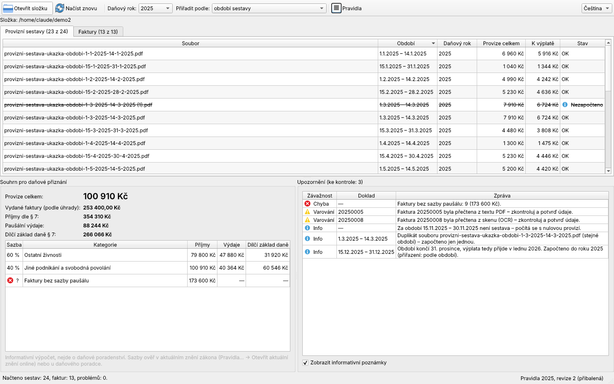
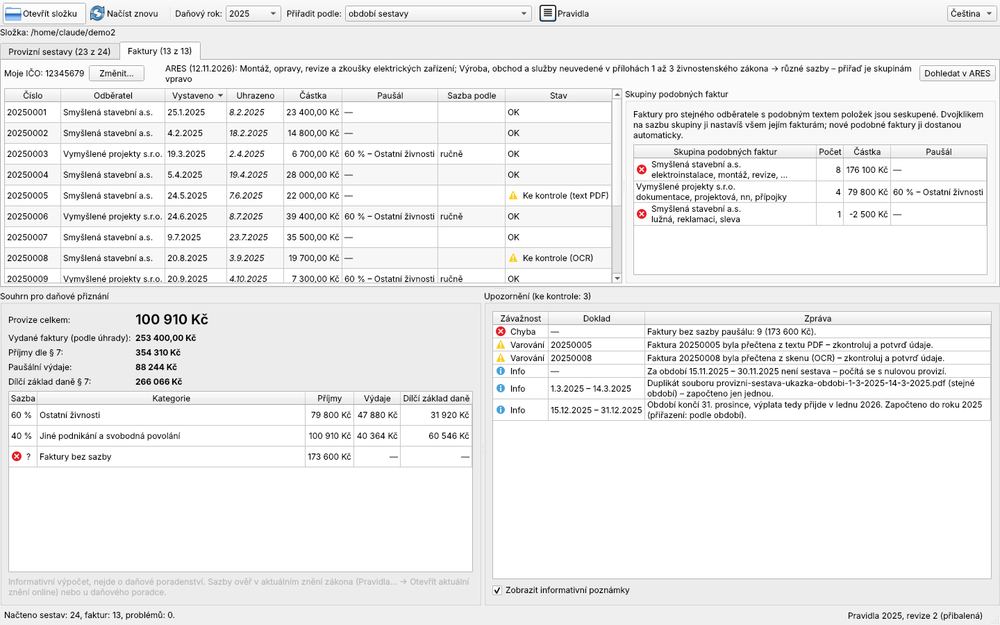
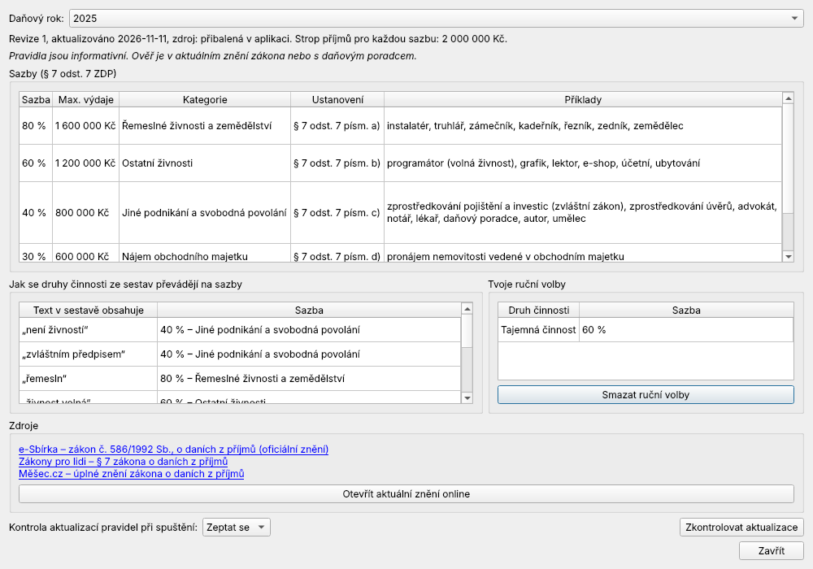

# Commission Tax Calc – provize pro daňové přiznání

**[English ↑](README.md)**

Desktopová aplikace, která přečte provizní sestavy finančního poradce FinTrust
stažené jako PDF **a vydané faktury** (ISDOC, text PDF nebo skeny přes OCR),
sečte je za daňový rok a spočítá údaje pro přiznání k dani z příjmů fyzických
osob: **příjmy dle § 7, paušální výdaje (30 / 40 / 60 / 80 %) a dílčí základ
daně**.



> Data na obrázcích jsou smyšlená, vygenerovaná skriptem
> `scripts/make_demo_data.py`.

## Co umí

- **Vybereš složku, dostaneš čísla.** Složku se sestavami vybereš tlačítkem nebo ji do okna přetáhneš. Sestavy se čtou na pozadí, takže okno nezamrzne.
- **Rozpad podle druhu činnosti.** Tabulka „Rozdělení příjmů … dle § 7 odst. 7“ se sečte za každou kategorii zvlášť a převede na sazbu paušálu, včetně zákonného stropu.
- **Kontroly, které chytí skutečné chyby:**
  - **období bez sestavy** se vypíšou. FinTrust za období s nulovou provizí sestavu nevydá, takže jde jen o poznámku, podle které poznáš i sestavu, kterou jsi zapomněl stáhnout,
  - **duplicity** z opakovaného stažení (`x (1).pdf`) se započtou jen jednou a **rozporné duplicity** (stejné období, jiná částka) se označí jako chyba,
  - **vnitřní konzistence** každé sestavy (shrnutí vs. tabulky vs. rozpad podle činnosti), takže změna formátu PDF neprojde bez povšimnutí,
  - **přelom roku**: sestava končící 31. 12. se vyplácí v lednu. Přiřazení k roku se dá zvolit podle *období* nebo podle *předpokládané výplaty*.
- **Vydané faktury** ve stejné složce. Appka je čte tím nejspolehlivějším dostupným způsobem:
  - **ISDOC** (český standard XML faktury), samostatně nebo vložený v PDF z Pohody, Money, iDokladu, Fakturoidu…: přesně,
  - **text PDF**: podle popisků (IČ, data, „Celkem k úhradě“),
  - **skeny**: OCR přes Tesseract s českým modelem.

  Údaje z textu a z OCR jsou označené **„Ke kontrole“**. Kontrolní dialog ukáže PDF vedle vyčtených údajů k opravě.
- **Daňový rok podle úhrady** (daňová evidence). Datum úhrady se odhadne podle splatnosti a jde upravit. Faktury přes přelom roku appka zvýrazní.
- **Počítají se jen tvoje faktury.** Tvoje IČO appka pozná z faktur a ty ho jednou potvrdíš. Přijaté faktury, zálohy a duplicity se vypíšou, ale nezapočítají. Dobropisy se odečítají a plátcům DPH se počítá částka bez DPH. Appka hlásí i mezery v číselné řadě.
- **Sazba paušálu u faktur** co nejrychleji:
  - **ARES** (volitelně, odešle se jen IČO): když všechny tvoje živnosti vedou na jednu sazbu, použije se automaticky,
  - jinak appka faktury **seskupí podle podobnosti** (odběratel + texty položek). Jedna sazba pro skupinu pokryje mnoho faktur a nové podobné faktury ji dostanou automaticky (s upozorněním ke kontrole).
- **Pravidla jako data.** Sazby, stropy, převod druhu činnosti na sazbu a odkazy na zákon jsou ve verzovaných JSON souborech po letech. Při spuštění si aplikace může stáhnout novější pravidla z tohoto repozitáře. Dialog „Pravidla“ ukáže, co je načtené, a otevře aktuální znění zákona online.
- **Čeština / angličtina**, přepínatelné za běhu.
- **Příkazová řádka** se stejným jádrem: `commission-tax-calc-cli <složka> --year 2025 [--json]`.





## Instalace a spuštění

**Windows:** stáhni `CommissionTaxCalc.exe` z [Releases](https://github.com/konvaa/commission_tax_calc/releases) a spusť ho. OCR (Tesseract s češtinou) je přibalené.

**Ze zdrojáků (Python 3.10+):**

```bash
git clone https://github.com/konvaa/commission_tax_calc.git
cd commission_tax_calc
python -m venv .venv && .venv\Scripts\activate
pip install -e ".[dev]"
commission-tax-calc
```

**OCR při spuštění ze zdrojáků:** nainstaluj [Tesseract](https://github.com/UB-Mannheim/tesseract/wiki)
a při instalaci zaškrtni jazyk **Czech**. Appka ho najde ve výchozí složce, v `PATH` nebo podle
proměnné `TESSERACT_CMD`. Bez něj se naskenované faktury také zobrazí, jen údaje zadáš ručně v kontrolním dialogu.

## Jak se aktualizují pravidla paušálů

1. Uprav `src/commission_tax_calc/rules/<rok>.json` (nebo zkopíruj loňský).
2. Zvyš `revision` a stejné číslo zapiš do `rules/index.json`.
3. Commitni a pushni do `main`. Nainstalované aplikace si změnu stáhnou při příští kontrole.

## Soukromí

- Sestavy se čtou jen lokálně a nic se neodesílá.
- Síťové požadavky jsou volitelné a appka se na ně předem zeptá: stažení pravidel z `raw.githubusercontent.com` a dotaz do ARES (`ares.gov.cz`), při kterém se odešle jen tvoje IČO.
- Tvoje rozhodnutí k fakturám (IČO, sazby, data úhrad, opravy) se ukládají lokálně do `%APPDATA%\commission_tax_calc\invoices.json`.
- `.gitignore` vylučuje všechna PDF. **Reálné sestavy nikdy necommituj**, protože obsahují jména klientů a čísla smluv.

## Upozornění

Jde o informativní výpočet, ne o daňové poradenství. Sazby a přiřazení příjmů
k roku si ověř v aktuálním znění zákona nebo u daňového poradce.

Architektura, návrhová rozhodnutí a vývoj jsou popsané v [anglickém README](README.md#how-it-works).

## Licence

[MIT](LICENSE) © 2026 Libor Konvičný
