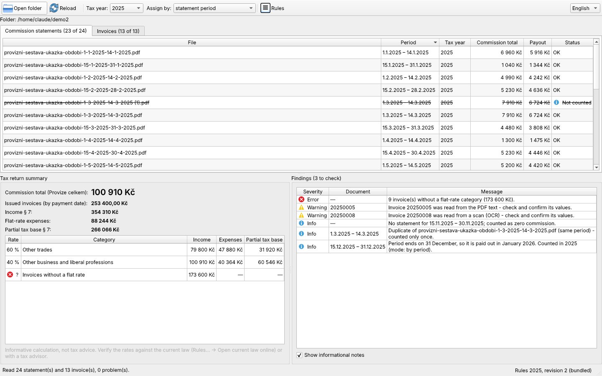
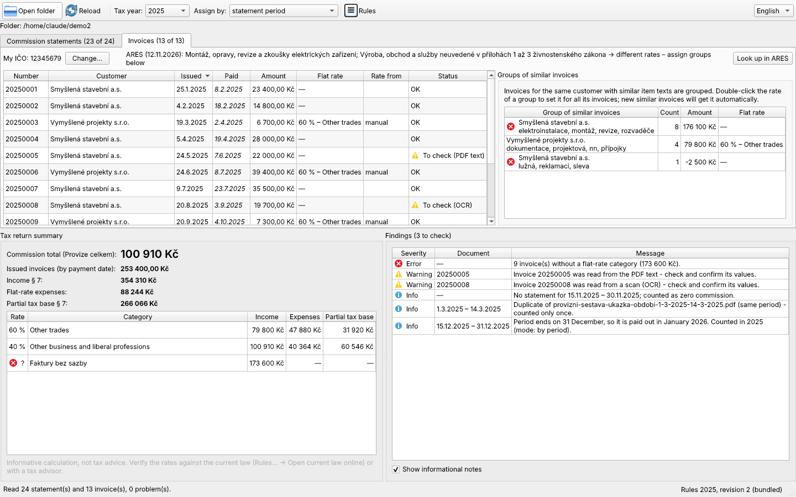

# Commission Tax Calc

[](https://github.com/konvaa/commission_tax_calc/actions/workflows/ci.yml)

-41cd52)


**[Česky ↓](README.cs.md)**

A desktop app that reads the commission statements ("provizní sestavy") a
FinTrust financial advisor downloads as PDF **and issued invoices** (ISDOC,
PDF text or scans via OCR), sums them up for a tax year and computes the
numbers for the Czech personal income tax return: income under § 7,
flat-rate expenses (30 / 40 / 60 / 80 %) and the partial tax base.





> All data in the screenshots is fictitious, generated by
> `scripts/make_demo_data.py`.

## Features

- **Folder in, numbers out.** Pick (or drag & drop) the folder with your PDFs. Each statement is parsed in a background thread.
- **Income split by activity type.** The "Rozdělení příjmů … dle § 7 odst. 7" table of each statement is summed per category and mapped to its flat-rate percentage, with the legal cap applied.
- **Checks that catch real mistakes:**
  - **periods without a statement** are listed. FinTrust issues none for a zero-commission period, so this is only a note that helps you spot a file you forgot to download,
  - **duplicates** from re-downloading (`x (1).pdf`) are counted once, and **conflicting** duplicates are flagged as errors,
  - **internal consistency** of every statement (summary vs. tables vs. activity split), so a format change in the PDF cannot slip through silently,
  - **year boundary**: statements ending on 31 Dec are paid in January. You can choose to assign by *period* or by *expected payout*.
- **Issued invoices** in the same folder, read in the most reliable way available:
  - **ISDOC** (the Czech XML invoice standard), standalone or embedded in the PDF by Pohoda, Money, iDoklad, Fakturoid…: exact,
  - **PDF text**: Czech invoice labels (IČ, dates, "Celkem k úhradě"),
  - **scans**: OCR with Tesseract (Czech model).

  Values read from text or OCR are marked *to check*. A review dialog shows the PDF next to the values for correction.
- **Tax year by payment date** (cash basis of "daňová evidence"). The payment date is estimated from the due date and can be edited; invoices crossing the year boundary are flagged.
- **Only your invoices count.** Your IČO is detected from the invoices and confirmed once. Invoices you *received*, advance invoices and duplicates are listed but not counted, credit notes are subtracted, and VAT payers count the amount without VAT. Gaps in the invoice number series are reported.
- **Flat rate for invoices**, as quickly as possible:
  - **ARES** (public register, optional, only your IČO is sent): if all your trades lead to one rate, it is applied automatically,
  - otherwise invoices are **grouped by similarity** (customer + item texts). One rate per group covers many invoices, and new similar invoices get it automatically (flagged for checking).
- **Rules as data.** Percentages, caps, the activity → rate mapping and links to the law live in versioned JSON files per tax year. At startup the app can download newer rules from this repository. The "Rules" dialog shows what is loaded and opens the current law online.
- **Czech / English UI**, switchable at runtime.
- **CLI** with the same core: `commission-tax-calc-cli <folder> --year 2025 [--my-ico 12345679] [--json]`.

## Install & run

**Windows:** download `CommissionTaxCalc.exe` from [Releases](https://github.com/konvaa/commission_tax_calc/releases) and run it. OCR (Tesseract with the Czech model) is included.

**From source (any OS, Python 3.10+):**

```bash
git clone https://github.com/konvaa/commission_tax_calc.git
cd commission_tax_calc
python -m venv .venv && .venv\Scripts\activate      # Linux/macOS: source .venv/bin/activate
pip install -e ".[dev]"
commission-tax-calc                                  # GUI
commission-tax-calc-cli path/to/statements --year 2025
```

**OCR when running from source:** install [Tesseract](https://github.com/UB-Mannheim/tesseract/wiki)
and select the **Czech** language during installation. The app finds it in
the default folder, on `PATH` or via the `TESSERACT_CMD` variable. Without it,
scanned invoices are still listed and you type the values in the review dialog.

No documents at hand? Generate a fictitious year of statements and invoices:

```bash
python scripts/make_demo_data.py demo_data
```

## How it works

```
src/commission_tax_calc/
├── core/                 pure Python, no Qt — unit-tested
│   ├── loader.py         classifies each file by content: statement / ISDOC / text / scan
│   ├── parser.py         PDF → text (pdfplumber) → Statement   (text step is a pure function)
│   ├── validation.py     consistency checks of one statement
│   ├── aggregator.py     statements: tax-year assignment, duplicates, gaps, totals
│   ├── isdoc.py          ISDOC XML (standalone, .isdocx, embedded in PDF) → Invoice
│   ├── invoice_text.py   invoice from PDF text / OCR output by Czech labels
│   ├── ocr.py            Tesseract via pytesseract, pages rendered by pdfium
│   ├── invoice_report.py invoices: own IČO, payment year, duplicates, rate choice
│   ├── grouping.py       groups of similar invoices (word-set similarity)
│   ├── ares.py           trades from the ARES register → suggested rate
│   ├── invoice_store.py  the user's invoice decisions, one JSON file
│   ├── rules.py          flat-rate rules: JSON loading, validation, remote update
│   ├── tax.py            expenses per rate (with cap) and partial tax base
│   └── issues.py         findings as codes + parameters (UI decides wording)
├── gui/                  PySide6 front-end
│   ├── main_window.py    window, state, wiring
│   ├── table_models.py   QAbstractTableModel for statements and the summary
│   ├── invoices_panel.py the Invoices tab (table, groups, own IČO, ARES)
│   ├── invoice_table_models.py  editable models + combo-box delegate for rates
│   ├── review_dialog.py  QPdfView next to the values read from the invoice
│   ├── workers.py        QObject workers moved to QThread (parsing, OCR, network)
│   ├── rules_dialog.py   rules, mapping, sources, manual choices
│   └── i18n.py           QTranslator, runtime language switching
├── rules/2024–2026.json  flat-rate rules + index.json for updates
├── translations/         app_cs.ts (source) → app_cs.qm (compiled)
└── cli.py
```

Design decisions, briefly:

| Decision | Why |
|---|---|
| `core` has no Qt import | Fast, simple tests. The CLI reuses it, and the GUI stays a thin layer. |
| Parsing split into *extract text* + *parse text* | Tests run on synthetic text. Real statements contain client data and are never committed. |
| Parser reads labelled lines and table **totals**, not individual rows | Columns are separated only by spaces, so a row like `9,5 100 950 Kč` is ambiguous. Totals are not, and cross-checking them still catches misreads. |
| `Decimal` for money | Floats cannot represent most decimal fractions, and a tax return should not drift by a fraction of a crown. |
| Flat-rate expenses rounded **down** | Filing is in whole CZK, and claiming slightly less expense is the safe direction. |
| Rules in versioned JSON per year | A law change is a one-file commit. Apps update without a new release, and older years keep their rules. Downloads are validated before they are cached. |
| Issues are codes, not sentences | The core stays language-neutral. The GUI translates the codes, the CLI prints English. |
| Qt Model/View instead of `QTableWidget` for data tables | Sorting works on real values (dates, amounts), not on formatted strings. |
| Worker `QObject` + `moveToThread` | The UI never freezes. Cross-thread signals go only to bound methods of GUI objects, so slots run in the GUI thread. |
| Qt-native i18n (`tr()`, `.ts`/`.qm`, `QTranslator`) | The standard Qt workflow, with runtime switching through `LanguageChange` events. |
| ISDOC first, then text, then OCR | The most reliable source wins. Heuristic results are never trusted silently and always go through the review dialog. |
| Invoice identity = ISDOC UUID or a hash of the file | Renaming or moving a PDF keeps the user's corrections and rates, and a re-downloaded copy is recognized as a duplicate. |
| Grouping by word-set similarity, not ML | A few hundred invoices are too few to train on, scikit-learn would add tens of MB, and a group's typical words show *why* invoices belong together. |
| Craft trades listed in the rules JSON | Only craft trades get 80 %. Matching trade names against the 41 craft trades of the law is robust and does not depend on undocumented ARES codes. |
| IČO checksum validated | Catches OCR misreads before an IČO decides "mine or not" or is sent to ARES. |
| Editing inside the table (delegate + `setData`) | The Qt way: the model declares editable cells and a delegate provides the editor (`QComboBox`, `QDateEdit`). The model only emits signals, and the main window saves the decision and recomputes. |

## Updating the flat-rate rules

1. Edit `src/commission_tax_calc/rules/<year>.json` (or copy last year's file).
2. Increase its `revision`, and set the same number in `rules/index.json`.
3. Commit and push to `main`. Installed apps pick it up on their next update check.

The test suite checks that `index.json` matches the files and that every file
passes validation.

## Privacy

- Statements are read locally. Nothing is uploaded.
- Network requests are optional and ask first: the rules download from `raw.githubusercontent.com`, and the ARES lookup at `ares.gov.cz`, which sends only your IČO.
- Your invoice decisions (own IČO, rates, payment dates, corrections) are stored locally in `%APPDATA%\commission_tax_calc\invoices.json`.
- `.gitignore` excludes all PDFs. **Never commit real statements**, because they contain client names and contract numbers.

## Development

```bash
pytest                       # GUI tests run headless with QT_QPA_PLATFORM=offscreen
ruff check . && ruff format --check .
python scripts/update_translations.py     # after changing UI texts
```

To run a regression test on your own statements locally (skipped in CI):

```powershell
$env:COMMISSION_SAMPLES_DIR = "C:\path\to\statements"; pytest tests/test_real_samples.py -v
```

Releases: push a tag `vX.Y.Z`. GitHub Actions runs the tests, builds the
Windows `.exe` with PyInstaller and attaches it to the release.

## Disclaimer

This is an informative calculation, not tax advice. Verify the rates and the
assignment of income to tax years against the current law or with a tax advisor.

## License

[MIT](LICENSE) © 2026 Libor Konvičný
